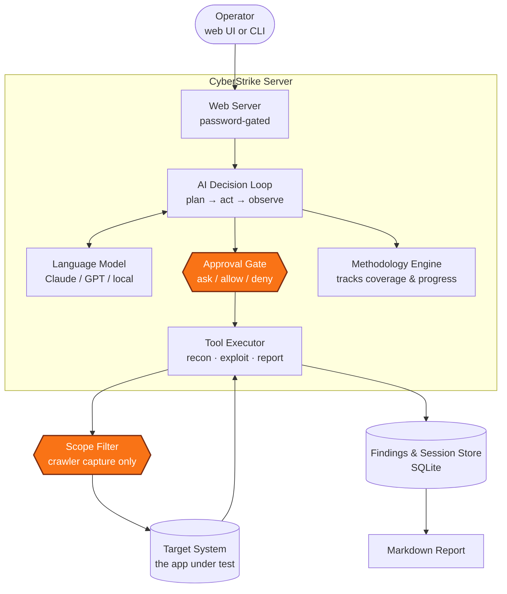
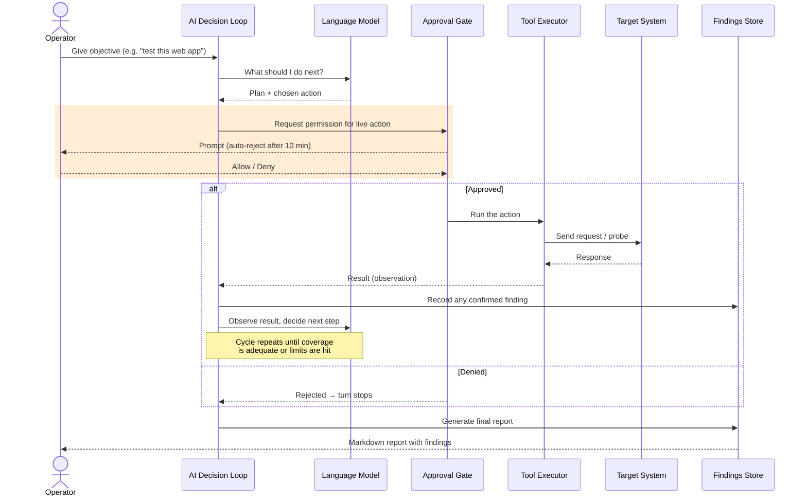
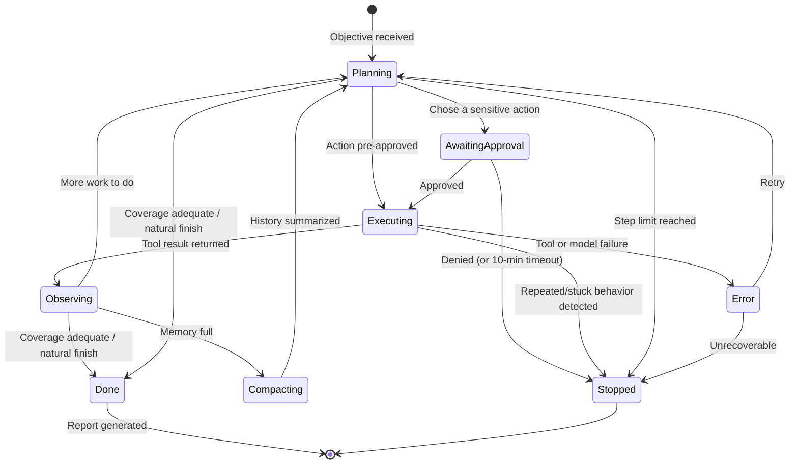

# CyberStrike — Visual Guide

**In plain terms:** CyberStrike is an AI-driven penetration-testing assistant. An operator points it at a target (typically a web application) and gives it an objective; the AI then plans its own steps, runs security tools and probes against the target, records any vulnerabilities it confirms, and writes up a report — running largely on its own for long stretches, with a human able to approve or block sensitive actions along the way. It's built on an existing open-source AI coding agent (OpenCode) with a security testing layer added on top.

Throughout these diagrams, **safety / approval / scope checkpoints are drawn in orange**.

---

## 1. System Architecture

**What it shows:** the major building blocks and how a request moves from the operator through the AI loop, out to the target, and into the findings store. Matters because it makes clear there's a single controlled path in and out — and where the guardrails sit on that path.

**In a meeting:** Everything runs inside one local server that's password-protected. The operator's objective flows into an AI loop that thinks with a language model and decides what to do next. Before any sensitive tool runs, it passes through an **approval gate**. Tools reach the live target, and anything reaching out through the built-in crawler is bounded by a **scope filter**. Confirmed findings land in a local database and can be turned into a report. The methodology engine on the side keeps score of how much of the target has been tested.

---

## 2. End-to-End Task Flow

**What it shows:** one representative run from objective to report, including the approval checkpoint before a live action and the loop-back where the agent decides its next move. Matters because it shows the human-in-the-loop control point and that the agent stops on its own, not just when told.

**In a meeting:** The operator states a goal once, then the agent runs the plan → act → observe cycle by itself. Each sensitive action pauses for the operator to approve or deny — and if nobody answers within ten minutes, it's automatically rejected rather than left hanging. Approved actions hit the target, results feed back in, and confirmed vulnerabilities are saved. The cycle repeats until the agent judges it has covered enough (or hits a safety limit), then it produces the report. A denial cleanly stops that turn.

---

## 3. Agent Loop — States & Transitions

**What it shows:** the states the agent moves through each turn and what ends the loop. Matters because a manager's first question about an autonomous tool is usually "what makes it *stop*?" — this shows multiple independent stop conditions, not just one.

**In a meeting:** The agent cycles between planning, (optionally) waiting for approval, executing, and observing. There are several independent ways it ends: it finishes naturally when it judges coverage is enough, it's **stopped** by a denied approval or a hard step limit, or it's cut off if it detects itself looping / stuck. When its working memory fills up it summarizes and continues rather than crashing. In short, the tool is designed to wind down on its own and has backstops so it can't run forever.

---

## 4. Tools & Capabilities Overview

**What it shows:** the categories of things the agent can do, grouped by purpose. Matters because it makes the tool's *reach* legible at a glance — it can do reconnaissance, active exploitation, and post-exploitation, and those are the capabilities that define the risk profile.

```mermaid
graph TD
    Root[CyberStrike Capabilities]

    Root --> Recon[Reconnaissance & Discovery]
    Root --> WebTest[Web App Testing]
    Root --> Exploit[Exploitation Helpers]
    Root --> PostEx[Post-Exploitation & Cloud]
    Root --> Report[Reporting & Tracking]
    Root --> Sys[General / System]

    Recon --> R1[Autonomous crawler]
    Recon --> R2[Web & code search]
    Recon --> R3[Intel & CVE / OSINT / DNS lookups]

    WebTest --> W1[Per-class testers:<br/>IDOR · auth · injection · SSRF · more]
    WebTest --> W2[Traffic capture & analysis]

    Exploit --> E1[Attack scripts:<br/>JWT · CORS · OAuth · file upload · race]
    Exploit --> E2[Injection probing]

    PostEx --> P1[Host hooks:<br/>Linux · Windows · macOS]
    PostEx --> P2[Cloud & container audits:<br/>AWS · Azure · GCP · K8s · CI/CD]

    Report --> Rep1[Record & triage findings]
    Report --> Rep2[Generate report]

    Sys --> S1[Shell commands]
    Sys --> S2[File read / write / edit]

    classDef reach fill:#f97316,stroke:#7c2d12,color:#fff,stroke-width:2px;
    class Exploit,PostEx reach;
```

**In a meeting:** The capabilities span the full testing arc. The lower-risk end is reconnaissance and reporting. The **higher-impact categories — highlighted — are active exploitation and post-exploitation** (host-level credential harvesting, privilege escalation, cloud audits): these actually act on a target rather than just observe it, which is where authorization and approval discipline matter most. It can also run arbitrary shell commands, so its practical reach is as broad as the machine it runs on.

---

## What this means for risk / safety

- **Human-in-the-loop is built in, but off by default in unattended runs.** Sensitive actions pause for operator approval, and an unanswered prompt auto-rejects after 10 minutes rather than hanging. However, the tool is designed to run for hours autonomously — approval discipline depends on someone actually being present to answer.
- **It knows how to stop itself.** Multiple independent stop conditions exist (natural completion, step limits, stuck-loop detection, denied approvals), so it's designed not to run away indefinitely.
- **Scoping is weak and mostly advisory — the biggest gap to flag.** There is **no enforced list of "allowed targets."** The only hard boundary is on what the built-in crawler captures; the agent's own scope check is just a warning the AI can ignore, and general tools (shell, web fetch) aren't restricted by target at all. **The operator is fully trusted to point it only at authorized systems.**
- **It resists fabricated findings.** High-severity results for certain vulnerability classes are automatically downgraded to "unconfirmed" unless backed by real evidence, reducing false alarms in reports.
- **Actions are observable but not permanently audited.** Every step emits a live event and findings are stored in a local database, but there's no tamper-proof audit log of what was done to a target — worth noting for any engagement that needs a defensible record.

---

*Diagrams derived from a source audit of the CyberStrike codebase; see the companion [Architecture & Behavior Guide](CyberStrike-Architecture-and-Behavior-Guide.md) for file-level detail and citations.*
